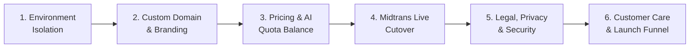

# Tumara — Go-To-Market (GTM) Preparation & Launch Checklist 🚀

> Dokumen acuan strategis dan teknis untuk mempersiapkan peluncuran Tumara v2 ke pasar Indonesia.  
> Dirancang terstruktur agar setiap langkah eksekusi aman, profesional, dan menghindari risiko operasional maupun teknis di masa depan.

---

## 📋 Status & Ringkasan Tahapan

---

## 1. Environment & Branch Isolation (Pemisahan Dev & Prod)

Saat ini semua perubahan langsung dideploy ke branch `main` yang terhubung ke server produksi (Render & Vercel). Sebelum pengguna berbayar masuk, kita **wajib** memisahkan jalur pengembangan agar eksperimen fitur tidak mengganggu pengguna aktif.

- [ ] **Git Branching Strategy**:
  - `main`: Khusus untuk versi stabil produksi yang dipakai pengguna umum.
  - `dev` / `staging`: Branch aktif untuk pengembangan harian dan penambahan fitur baru.
  - Alur: Koding di `dev` $\rightarrow$ Uji coba di staging $\rightarrow$ Buat PR (Pull Request) $\rightarrow$ Merge ke `main`.
- [ ] **Database Isolation (MongoDB Atlas)**:
  - Buat 2 database terpisah di cluster Atlas yang sama:
    - `fincfo_prod`: Khusus data pengguna sungguhan (bersih dari data uji coba).
    - `fincfo_dev`: Khusus pengujian lokal dan otomasi test.
  - Konfigurasi `DB_NAME=fincfo_prod` pada environment Render produksi.
- [ ] **Deployment Environment Isolation**:
  - **Frontend**: Vercel secara otomatis menyediakan *Preview Deployment* setiap kali ada push ke branch `dev` atau Pull Request. Domain utama (`tumara.id`) hanya akan menarik kode dari `main`.
  - **Backend**: Buat service kedua di Render (misal: `tumara-backend-dev`) atau gunakan environment lokal untuk pengetesan backend sebelum naik ke produksi.
- [ ] **Pembersihan Data Pengujian (Data Cleansing)**:
  - Sebelum hari peluncuran, bersihkan akun-akun tester dummy dari database produksi agar riwayat net worth dan analitik sistem dimulai dari kondisi murni.

---

## 2. Custom Domain & Kepercayaan Brand (Trust & Credibility)

Aplikasi finansial mengelola data yang sangat sensitif (rekening bank, pengeluaran harian, catatan utang/kartu kredit). Pengguna menuntut tingkat kepercayaan (*trust*) yang tinggi.

### Analisa Biaya & Kelayakan (Feasibility & Cost):
1. **Apakah Vercel Meminta Biaya Berlangganan untuk Custom Domain?**
   - **TIDAK**. Fitur Custom Domain di Vercel adalah **100% GRATIS** bahkan pada paket **Vercel Hobby (Free Tier)**. Vercel juga otomatis memberikan sertifikat SSL (HTTPS) gratis seumur hidup.
   - Anda **TIDAK PERLU** berlangganan Vercel Pro ($20/bulan) hanya untuk menggunakan domain sendiri.
2. **Berapa Biaya yang Sebenarnya Diperlukan?**
   - Anda hanya perlu membeli nama domain itu sendiri dari registrar (seperti Niagahoster, Domainesia, Namecheap, Cloudflare Registrar, atau IDwebhost).
   - Biaya domain:
     - Domain `.id` (Sangat direkomendasikan untuk target pasar Indonesia): **± Rp 200.000 – Rp 250.000 / tahun**.
     - Domain `.app` atau `.com`: **± Rp 150.000 – Rp 200.000 / tahun**.
   - **Kesimpulan: SANGAT WORTH IT**. Dengan modal sekitar Rp 15.000–Rp 20.000 per bulan untuk domain, Tumara langsung terlihat sebagai entitas resmi dan profesional dibanding domain bawaan `tumara-v2.vercel.app`.

### Checklist Aksi Domain:
- [ ] Pilih dan beli domain resmi (misal: `tumara.id`, `tumara.app`, atau `tumara.co.id`).
- [ ] Hubungkan domain ke Vercel: Buka *Vercel Project Settings* $\rightarrow$ *Domains* $\rightarrow$ Masukkan domain $\rightarrow$ Atur DNS (CNAME / A Record) di dashboard registrar domain.
- [ ] (Opsional) Hubungkan subdomain API untuk backend (misal: `api.tumara.id`) ke Render via custom domain setting di Render dashboard.

---

## 3. Analisa Ulang Harga Produk & Keseimbangan Kuota AI

Prinsip bisnis Tumara: **"Sekali bayar untuk akses selamanya, tidak pelit kuota, harga masuk akal, dan tersedia opsi booster instan."**

### Analisa Keekonomian Token AI (Google Gemini Flash):
- Biaya 1x scan struk via Gemini Flash: ~1.500 token $\approx$ \$0.0003 (sekitar **Rp 5 – Rp 7 per struk**).
- Biaya 1x chat asisten / quick parse text: ~500 token $\approx$ \$0.00005 (sekitar **Rp 1 per chat**).
- Artinya, memberikan kuota yang layak sama sekali tidak membebani server secara finansial, namun memberikan **persepsi nilai (*perceived value*) yang jauh lebih premium dan tidak pelit** di mata pengguna.

### Rekomendasi Penyesuaian Paket & Kuota:

| Paket | Harga Lisensi (Sekali Bayar) | Kuota Scan Struk Bulanan | Kuota Teks AI Bulanan | Fitur Unggulan |
|---|---|---|---|---|
| **Starter Personal** | **Rp 49.000** | **10 Scan / bulan** *(sebelumnya 3)* | **20 Teks / bulan** *(sebelumnya 5)* | Pencatatan manual unlimited, Budget 50/30/20, Health Score, Kalender Tagihan, Ekspor CSV. |
| **Pro Tumara AI** *(Best Value)* | **Rp 99.000** | **60 Scan / bulan** *(sebelumnya 50)* | **150 Teks / bulan** *(sebelumnya 100)* | Semua fitur Starter + AI Financial Advisor interaktif, Weekly AI Recap, Itemized Struk Scanner, Mode Blur. |
| **Family Partner** | **Rp 169.000** | **150 Scan / bulan** *(sebelumnya 120)* | **300 Teks / bulan** *(sebelumnya 250)* | 1 Lisensi untuk 2–3 akun keluarga, Shared Net Worth, Split Tracker 50/50 / Proporsional, WA Priority. |

### Strategi AI Booster (Add-On Pembelian Ulang):
Untuk pengguna aktif yang kuotanya habis sebelum tanggal 1:
- **Booster Scan Mini**: Rp 15.000 dapat +30 Scan Struk (Saldo aktif selamanya, tidak hangus di akhir bulan).
- **Booster Pro AI Pack**: Rp 25.000 dapat +75 Scan Struk & +150 Teks AI (Aktif selamanya).
- *Dampak:* Tumara tetap memegang prinsip sekali bayar untuk platform, namun memiliki sumber pendapatan berulang (*recurring revenue*) yang sehat dan etis dari pengguna berat AI.

---

## 4. Cutover Payment Gateway (Midtrans Production)

Saat ini alur pembayaran sudah berjalan sempurna dalam **Mode Simulasi Instan (Sandbox Demo)**. Untuk peluncuran publik:

- [ ] **Pendaftaran & Verifikasi Merchant Midtrans**:
  - Daftar di [midtrans.com](https://midtrans.com) (Pilih akun Bisnis / Perorangan).
  - Unggah dokumen verifikasi (KTP, NPWP, dan nomor rekening penampung pencairan dana).
- [ ] **Aktifkan Metode Pembayaran**:
  - QRIS Dinamis (GoPay, OVO, DANA, ShopeePay, BCA Mobile, Livin', dll.).
  - Virtual Account (BCA, Mandiri, BNI, BRI, Permata).
- [ ] **Konfigurasi Environment Production**:
  - Di Render (Backend): Set `MIDTRANS_SERVER_KEY` dengan Production Server Key dari dashboard Midtrans.
  - Di Vercel (Frontend): Set `REACT_APP_MIDTRANS_CLIENT_KEY` dengan Production Client Key Midtrans.
  - Di Dashboard Midtrans: Atur **Payment Notification URL** mengarah ke: `https://<backend-domain>/api/orders/webhook/midtrans`.
- [ ] **Uji Coba Transaksi Nyata (Rp 1.000 - Rp 10.000)**:
  - Lakukan 1x transaksi nyata via QRIS untuk memastikan uang masuk ke settlement Midtrans dan lisensi otomatis aktif.

---

## 5. Aspek Legal, Privasi & Keamanan (Trust & Compliance)

Agar tidak menjadi celah atau bumerang hukum di masa depan:

- [ ] **Halaman Kebijakan Privasi (Privacy Policy)**:
  - Tegaskan bahwa Tumara **100% tidak menjual data finansial ke broker iklan atau pihak ketiga**.
  - Jelaskan enkripsi password dengan standar `bcrypt`.
- [ ] **Halaman Syarat & Ketentuan (Terms of Service)**:
  - Cantumkan aturan lisensi sekali bayar (*Lifetime personal use*).
  - Larangan menyalahgunakan kuota AI untuk scraping atau aktivitas ilegal.
- [ ] **Disclaimer Non-OJK (Penting!)**:
  - Cantumkan penafian jelas di footer dan halaman syarat:  
    > *"Tumara adalah perangkat lunak manajemen keuangan dan pencatatan anggaran pribadi. Tumara bukan penasihat investasi berlisensi OJK dan tidak menghimpun, mengelola, atau memutar dana pengguna. Semua keputusan finansial sepenuhnya berada di bawah kendali pengguna."*
- [ ] **Backup Otomatis Database**:
  - Aktifkan fitur *Continuous Cloud Backup* di MongoDB Atlas agar snapshot data tersimpan berkala dan aman dari insiden data hilang.
- [ ] **Penyempitan Akses CORS**:
  - Di `backend/.env` produksi, batasi `CORS_ORIGINS` hanya ke domain resmi Anda (misal: `https://tumara.id`) dan hapus origin localhost jika tidak diperlukan.

---

## 6. Layanan Pelanggan & Strategi Funnel Peluncuran

- [ ] **Saluran Bantuan Pelanggan (Customer Support)**:
  - Siapkan akun WhatsApp Business resmi dengan format pesan bantuan instan.
  - Tampilkan tombol *"Butuh Bantuan? Hubungi Kami"* di footer Landing Page dan menu Pengaturan Akun.
- [ ] **Early Bird Launch Campaign**:
  - Buat kupon atau kode akses promo terbatas (misal: potongan 20% untuk 100 pembeli pertama).
  - Manfaatkan Tech Twitter Indonesia, komunitas frugal living / perencanaan keuangan di Instagram dan TikTok.
- [ ] **Loop Feedback Pengguna**:
  - Evaluasi umpan balik dari 50 pengguna pertama untuk melihat fitur apa yang paling sering digunakan dan apa yang masih membingungkan.

---

_Dokumen ini akan terus diperbarui dan dijadikan kompas bersama dalam setiap tahapan persiapan Go-To-Market Tumara._
