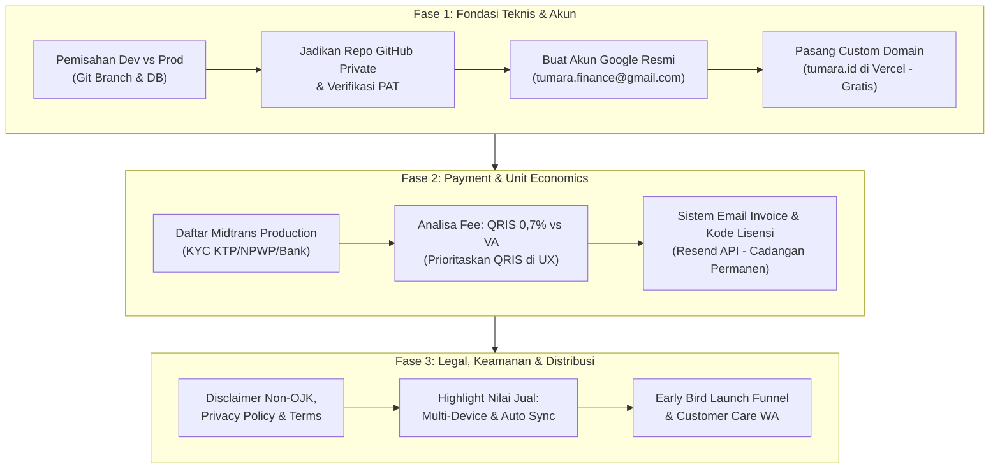

# Tumara — Go-To-Market (GTM) Master Preparation & Launch Checklist 🚀

> Dokumen acuan strategis, finansial, dan teknis untuk mempersiapkan peluncuran komersial Tumara v2 ke pasar Indonesia.  
> Dirancang terstruktur agar setiap keputusan funnel, infrastruktur, perizinan, dan penetapan harga menghasilkan konversi tinggi, aman secara hukum, dan memaksimalkan margin pendapatan bersih (*net margin*).

---

## 📋 Status & Peta Jalan Peluncuran (Roadmap)

---

## 1. Fondasi Teknis & Akun Terpusat

### A. Pemisahan Environment (Development vs Production)
Saat ini alur perubahan langsung menyentuh `main` (Render & Vercel). Sebelum ada transaksi uang sungguhan:
- [ ] **Git Branching Strategy**:
  - `main`: Khusus untuk versi stabil produksi yang diakses pengguna umum.
  - `dev`: Branch aktif untuk pengujian internal, eksperimen UI, dan penambahan fitur.
  - Alur: Koding di branch `dev` $\rightarrow$ Uji coba lokal/preview $\rightarrow$ Buat Pull Request $\rightarrow$ Merge ke `main`.
- [ ] **Isolasi Database (MongoDB Atlas)**:
  - Buat 2 database terpisah di cluster Atlas yang sama:
    - `fincfo_prod`: Khusus pengguna riil (bebas dari data dummy/testing).
    - `fincfo_dev`: Khusus otomatisasi testing dan eksperimen lokal.
  - Konfigurasi `DB_NAME=fincfo_prod` pada environment Render produksi.
- [ ] **Pembersihan Data Pengujian (Data Cleansing)**:
  - Sebelum hari peluncuran, hapus semua akun pengujian dummy dari database produksi agar riwayat *net worth* dan metrik analitik dimulai dari kondisi bersih.

### B. Menjadikan Repositori GitHub "Private" & Keamanan PAT
- [ ] **Apakah Mengubah Repo ke Private Akan Memutus Akses PAT?**
  - **TIDAK**. Personal Access Token (PAT) GitHub yang tersimpan di macOS Keychain (`osxkeychain`) memiliki izin akses penuh (*repo scope*) ke seluruh repositori di bawah akun `Jomen034`, baik publik maupun privat.
  - Perubahan dari Public ke Private di GitHub **tetap mengizinkan push/pull dari terminal lokal Anda** tanpa perlu membuat token baru.
- [ ] **Dampaknya ke Vercel & Render**:
  - Vercel dan Render terhubung via **GitHub App OAuth Integration**.
  - Saat repositori diubah menjadi private, pastikan di menu GitHub: *Settings* $\rightarrow$ *Applications* $\rightarrow$ *Vercel* / *Render* $\rightarrow$ Centang akses ke repositori `tumara-v2` (biasanya otomatis langsung aktif jika opsi default "All repositories" dipilih).

### C. Akun Google Terpusat (Single Source of Truth)
- [x] **Akun Gmail Resmi Tumara:** `tumara.finance@gmail.com` ✅ (Sudah dibuat)
  - **Tujuan:** Memisahkan seluruh aset digital bisnis dari email pribadi agar terstruktur, profesional, dan aman dari kebocoran data personal.
  - **Daftar Pemanfaatan Utama:**
    1. Registrasi Akun Merchant Midtrans & Pembukaan Rekening Usaha
    2. Registrasi Akun Pengiriman Email Transaksional (Resend / Brevo)
    3. Registrasi Akun Media Sosial Resmi (Instagram `@tumara.app`, X/Twitter, TikTok)
    4. Google Search Console & Google Analytics 4
    5. Inbox Layanan Pengguna & Dukungan Teknis (*Customer Care Inbox*)

---

## 2. Kredibilitas Brand, Custom Domain & Multi-Device Sync

### A. Analisa Custom Domain & Biaya Alat Gratisan (Vercel & Render)
- [ ] **Biaya Vercel**: **Rp 0 (GRATIS)**.
  - Vercel Hobby (paket gratis) mengizinkan pemasangan custom domain tanpa batas dengan sertifikat SSL (HTTPS) gratis seumur hidup.
  - Anda **TIDAK PERLU** berlangganan Vercel Pro (\$20/bulan).
- [ ] **Biaya Domain**:
  - Domain `.id` (Sangat disarankan untuk pasar Indonesia): **± Rp 200.000 – Rp 250.000 / tahun** (sekitar Rp 18.000/bulan).
  - Domain `.app` atau `.com`: **± Rp 150.000 – Rp 200.000 / tahun**.
  - Registrar rekomendasi: Niagahoster, Domainesia, IDwebhost, atau Cloudflare Registrar.
- [ ] **Tingkat Kepentingan**: **Wajib untuk Go-To-Market**.
  - Nama domain seperti `tumara.id` memberikan *trust* dan rasa aman instan bagi pembeli yang hendak memasukkan catatan keuangan dan rekening pribadi, dibandingkan URL default `tumara-v2.vercel.app`.

### B. Nilai Jual "Multi-Device & Auto-Sync Real-Time"
- [ ] **Kenapa Sangat Kuat Dijual ke Pasar?**
  - Banyak aplikasi keuangan lokal atau spreadsheet offline hanya bisa dibuka di 1 ponsel; jika ponsel rusak atau hilang, seluruh riwayat keuangan lenyap.
  - Tumara berbasis Cloud DB & PWA terenkripsi:
    - **Di Smartphone (Android & iOS):** Catat pengeluaran cepat saat berbelanja di kasir / restoran.
    - **Di Laptop / PC Kantor:** Evaluasi anggaran 50/30/20 dan net worth bulanan di layar lebar.
    - **Real-Time Auto-Sync:** Transaksi yang dicatat di HP seketika muncul di browser laptop tanpa perlu sinkronisasi manual.
- [ ] Poin ini sudah ditegaskan pada *Hero Badges*, *Feature Grid*, dan *FAQ* Landing Page Tumara.

---

## 3. Komparasi Payment Gateway (Midtrans vs Lynk.id) & Analisa Margin

### A. Rincian Biaya Transaksi (Fee Comparison)

| Parameter | Midtrans (Payment Gateway Murni) | Lynk.id (Platform Toko Kreator) |
|---|---|---|
| **Biaya Bulanan** | **Rp 0 (Gratis selamanya)** | **Rp 0** (Free) atau **Rp 99.000/bln** (Pro) |
| **Fee Transaksi QRIS** | **0,7%** (Resmi Bank Indonesia) | **5%** (Free) atau **3%** (Pro) |
| **Fee Virtual Account** | **IDR 4.000 / transaksi** | Mengikuti potongan platform 5% / 3% |
| **Alur Pengguna (UX)** | **Seamless In-App Modal (Snap)**: Pembeli tetap berada di web Tumara, auto-login dan aktivasi instan tanpa lempar halaman. | **External Redirect**: Pembeli dilempar ke halaman `lynk.id/...`, memutus flow auto-login langsung ke dashboard. |

### B. Simulasi Margin Pendapatan Bersih Tumara:

| Paket & Harga | Metode Pembayaran | Biaya Midtrans | Pendapatan Bersih Tumara | Margin Keuntungan |
|---|---|---|---|---|
| **Starter (Rp 49.000)** | **QRIS** | **Rp 343** (0,7%) | **Rp 48.657** | **99,3%** |
| | Virtual Account | Rp 4.000 | Rp 45.000 | 91,8% |
| **Pro (Rp 99.000)** | **QRIS** | **Rp 693** (0,7%) | **Rp 98.307** | **99,3%** |
| | Virtual Account | Rp 4.000 | Rp 95.000 | 95,9% |
| **Family (Rp 169.000)** | **QRIS** | **Rp 1.183** (0,7%) | **Rp 167.817** | **99,3%** |
| | Virtual Account | Rp 4.000 | Rp 165.000 | 97,6% |

> [!TIP]
> **Rekomendasi Strategi UX Checkout:**
> Midtrans adalah pemenang mutlak karena biaya MDR QRIS hanya **0,7%** (dibandingkan Lynk.id yang memotong 5% = Rp 4.950 per transaksi Pro).  
> Pada modal checkout Tumara, **QRIS telah diatur sebagai metode default yang direkomendasikan** (*Recommended - Instan & Bebas Biaya Admin*).

---

## 4. Arsitektur Funnel Pembayaran & Pengiriman Email Konfirmasi

### A. Analisa Funnel: "Langsung Masuk Dashboard" vs "Wajib Verifikasi Email"
Pengguna mengusulkan: *Apakah setelah bayar sukses, user wajib buka email dan klik link konfirmasi dulu baru bisa masuk?*

#### Hasil Evaluasi Konversi (UX Drop-Off Rate):
- **Moment of Highest Excitement**: Saat pembeli baru saja mentransfer uang, rasa antusias mereka berada di puncak.
- Jika pengguna **dipaksa** membuka tab baru, membuka aplikasi Gmail, menunggu email masuk (yang terkadang terlambat 1–2 menit atau terselip di tab *Promosi/Spam*), tingkat batal onboarding (*onboarding drop-off rate*) melonjak **25% – 40%**.
- Pembeli bisa merasa was-was: *"Uang saya sudah terpotong, kenapa belum dapat akses langsung?"*

### B. Solusi Ideal (The "Golden Flow" - Zero Friction + Dual Backup):
Kita menerapkan pendekatan gabungan terbaik:
1. **Akses Instan di Web (Zero Friction)**:
   - Setelah pembayaran sukses, layar langsung menampilkan tanda centang hijau, kode lisensi (`TMR-PRO-XXXXXX`), dan tombol **"Masuk ke Dashboard Sekarang ➔"** yang otomatis meng-autentikasi pengguna.
2. **Pengiriman Email Invoice & Lisensi Permanen (Background Backup)**:
   - Secara bersamaan di server (background), backend mengirimkan email tanda terima transaksi profesional via **Resend API**.
   - **Isi Email:**
     - Invoice bukti pembayaran resmi.
     - Ringkasan paket yang dibeli (Starter / Pro / Family).
     - Kode Lisensi unik untuk disimpan selamanya.
     - Tautan Magic Login: `https://tumara.id/login?email=...` jika kelak user ingin login di HP atau laptop baru.
3. *Keuntungan:* Pengguna langsung merasakan pengalaman memuaskan tanpa jeda, namun tetap memiliki arsip bukti bayar dan lisensi resmi di inbox email mereka selamanya.

- [ ] **Checklist Integrasi Resend**:
  - Daftar akun di [resend.com](https://resend.com) (Gratis 3.000 email/bulan, 100 email/hari).
  - Verifikasi domain pengirim (misal: `halo@tumara.id` atau `billing@tumara.id`).
  - Masukkan `RESEND_API_KEY` di environment Render.
  - Buat template email konfirmasi HTML modern bernuansa obsidian & emerald Tumara.

---

## 5. Aspek Legalitas, Privasi & Kepatuhan Anti-Boomerang

Agar peluncuran aman dari risiko regulasi maupun kesalahpahaman pengguna:

- [ ] **Penafian Resmi Non-OJK (Wajib di Footer & Halaman Ketentuan)**:
  > *"Tumara adalah perangkat lunak independen untuk pembukuan dan perencanaan keuangan pribadi. Tumara bukan penasihat investasi berlisensi OJK dan tidak menghimpun, mengelola, meminjamkan, atau memutar dana publik. Seluruh keputusan finansial dan alokasi anggaran sepenuhnya berada di bawah kendali mandiri pengguna."*
- [ ] **Kebijakan Privasi (Privacy Policy)**:
  - Pernyataan tegas bahwa Tumara **100% tidak pernah memonetisasi, menjual, atau menyewakan data finansial pengguna** ke broker iklan pihak ketiga.
  - Password dienkripsi dengan standar industri `bcrypt` (bahkan tim Tumara tidak dapat melihat password pengguna).
- [ ] **Syarat & Ketentuan Lisensi (Terms of Service)**:
  - Penjelasan aturan lisensi seumur hidup (*Personal Lifetime License*).
  - Kebijakan Fair Usage Policy (FUP) kuota AI bulanan yang transparan.
- [ ] **Backup Otomatis Database**:
  - Aktifkan fitur *Continuous Backup / Daily Snapshot* di MongoDB Atlas agar data pengguna terlindungi dari insiden kegagalan sistem.

---

## 6. Saluran Layanan Pelanggan (Customer Support) & Peluncuran

- [ ] **Saluran Bantuan WhatsApp Business**:
  - Daftarkan nomor khusus WhatsApp Business atas nama **Tumara Official**.
  - Siapkan link instan: `https://wa.me/628xxxxxxxxxx?text=Halo%20Tim%20Tumara,%20saya%20butuh%20bantuan%20terkait...`.
  - Pasang tombol bantuan di footer Landing Page dan menu Pengaturan Akun.
- [ ] **Strategi Distribusi Peluncuran (Launch Channels)**:
  - **Tech Twitter / X Indonesia**: Thread perkenalan produk finansial karya anak bangsa dengan visual screenshot yang bersih.
  - **Komunitas Frugal Living & Melek Finansial (Instagram / TikTok)**: Tampilkan video demo 15 detik fitur Scan Struk OCR itemized dan Budgeting 50/30/20.
  - **Kupon Promo Early Bird**: Diskon khusus untuk 50 atau 100 pembeli pertama untuk memicu *social proof* dan testimoni awal.

- [ ] **SOP Penanganan Transaksi Bermasalah & Refund Policy**:
  - Apa yang terjadi jika pembeli sudah transfer via e-wallet tapi koneksi internet mereka terputus sebelum webhook terpanggil?
  - Siapkan protokol CS: Admin memverifikasi order di dashboard Midtrans, lalu memberikan kode lisensi manual atau melakukan re-trigger via endpoint status.
  - Garansi 7 hari uang kembali jika terjadi kendala teknis yang tidak dapat diselesaikan oleh sistem.

---

## 7. Kesiapan Operasional, Reliabilitas & Pencegahan Kendala Hari-H (Day-1 Resilience)

Hal-hal teknis yang sering kali menjadi "batu sandungan tak terduga" bagi pembuat aplikasi di hari peluncuran:

### A. Mengatasi Masalah "Cold Start" Backend di Render Free Tier
- **Status:** **SUDAH AKTIF & SELESAI (100% Resolved)** ✅
  - [x] Pinger otomatis di **cron-job.org** sudah aktif berjalan mem-ping `https://tumara-backend.onrender.com/api/health` setiap 10 menit.
  - [x] Riwayat eksekusi terverifikasi konsisten sukses (`200 OK`, latency ~1.03 detik), sehingga server backend Render selalu dalam kondisi hangat (*warm*) dan siap merespons checkout seketika.
  - [ ] *(Opsional masa depan)*: Jika kelak trafik harian sudah sangat tinggi, bisa upgrade ke Render Starter (\$7/bulan) untuk RAM dan CPU dedicated yang lebih besar.

### B. Pratinjau Tautan Media Sosial (Social Share Card / Open Graph)
- **Potensi Kendala:** Saat link `tumara.id` dibagikan di grup WhatsApp, Twitter/X, atau bio Instagram, link hanya muncul berupa teks polos tanpa gambar pratinjau yang memikat.
- **Solusi (Sudah Diterapkan di `index.html`):**
  - [x] Tag Open Graph (`og:title`, `og:description`, `og:image`, `og:url`) dan `twitter:card` sudah dipasang dengan gambar banner resolusi tinggi (`logo512.png`).
  - [ ] Uji coba pratinjau link menggunakan **Facebook Sharing Debugger** atau kirim tes ke WhatsApp chat pribadi.

### C. Monitoring Error & Notifikasi Crash Real-Time (Sentry)
- **Potensi Kendala:** Jika ada calon pembeli menggunakan browser spesifik (misal browser bawaan Xiaomi atau Safari versi lama) dan mendapati tombol checkout tidak bisa diklik, Anda tidak akan pernah mengetahuinya tanpa komplain pengguna.
- **Solusi:**
  - [ ] Pasang **Sentry** (sentry.io - paket gratis mengizinkan 5.000 error/bulan).
  - [ ] Begitu ada error JavaScript di sisi browser pengguna atau exception di backend, Sentry langsung mengirimkan notifikasi ke email Anda lengkap dengan nomor baris kode dan tipe perangkat pengguna.

### D. Analitik Perilaku Pengguna & Corong Konversi (Funnel Analytics)
- **Potensi Kendala:** Anda tidak tahu dari 100 pengunjung, berapa yang klik tombol "Beli", berapa yang membuka modal, dan di kolom isian mana mereka membatalkan pembelian (*drop-off*).
- **Solusi:**
  - [ ] Pasang **PostHog** (posthog.com - gratis 1 juta events/bulan) atau **Google Analytics 4**.
  - [ ] PostHog memiliki fitur luar biasa: **Session Replay** (rekaman pergerakan mouse/taps pengguna secara anonim), sehingga Anda bisa melihat langsung di mana letak kebingungan calon pengguna baru.

### E. Verifikasi Google OAuth untuk Produksi (Google Cloud Console)
- **Potensi Kendala:** Jika login menggunakan Google OAuth diaktifkan untuk publik, aplikasi yang belum diverifikasi di Google Cloud Console akan menampilkan layar peringatan merah: *"Google hasn't verified this app"*.
- **Solusi:**
  - [ ] Tambahkan domain resmi (`tumara.id`) ke daftar *Authorized JavaScript Origins* dan *Authorized Redirect URIs* di Google Cloud Console.
  - [ ] Pastikan link Privacy Policy dan Terms of Service terisi di konsol Google sebelum membuka login Google untuk publik.
  - [ ] Atau posisikan Email & Password sebagai metode pendaftaran utama yang paling stabil dan bebas blokir.

### F. Kepatuhan UU Perlindungan Data Pribadi (UU PDP No. 27/2022)
- [ ] Pastikan hak pengguna untuk menghapus akun dan mengekspor data finansial tercantum jelas di halaman Privasi (Tumara sudah mendukung fitur ekspor CSV dan penghapusan data di menu Pengaturan Akun).

---

_Dokumen ini adalah aset panduan resmi tim Tumara menuju peluncuran komersial yang sukses dan berkelanjutan._
